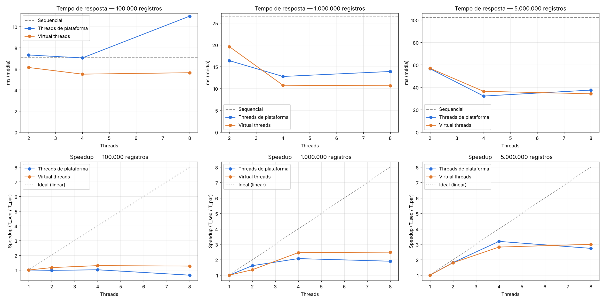

# Atividade — Threads no Rota Vital

## Operação escolhida

**Relatório estatístico do histórico nacional de requisições** (painel consultado o dia inteiro).
Para cada grupo **UF × tipo sanguíneo (ABO/Rh) × hemocomponente** (27 × 8 × 3 = 648 grupos), o serviço calcula:
requisições, unidades, urgentes, atendidas / não atendidas, % dentro do SLA (urgente ≤ 1 h, rotina ≤ 4 h),
tempo de espera médio / mínimo / máximo, p50 e p90 (por histograma de faixas de 5 min), demanda por hora do dia
e ranking dos 10 hospitais com mais unidades requisitadas.

- **Big-O sequencial:** O(N) tempo (uma passada nos N registros) + O(G) memória (G = 648 grupos).
- **Gargalo:** processamento — os dados já estão em memória e cada registro exige vários cálculos e atualizações de agregados.
- **Particionável:** cada registro contribui só para o seu grupo; os contadores são somas de inteiros (associativas e comutativas),
  então cada thread agrega a própria fatia e os parciais são somados no final.
- **Versão paralela:** O(N/T) por thread + O(T·G) na agregação. O trabalho total continua O(N).

## Código

| Arquivo | Papel |
|---|---|
| `controller/RequestStatisticsController.java` | Endpoints REST |
| `service/RequestStatisticsService.java` | Versão sequencial, versão com threads (`ExecutorService`) e benchmark |
| `service/RequestStatisticsAccumulator.java` | Agregado parcial de cada thread (`accept`) e agregação final (`merge`) |
| `service/RequestHistoryDataset.java` | Gera os dados sintéticos (determinístico, semente fixa) e os mantém em memória |
| `model/RequestHistoryRecord.java` | Registro do histórico |
| `test/.../RequestStatisticsServiceTest.java` | Garante que 1, 2, 3, 4, 7, 8, 16 threads (plataforma e virtuais) devolvem **exatamente** o mesmo relatório que a sequencial |

Não há estado compartilhado entre threads: cada uma usa o seu próprio `RequestStatisticsAccumulator`,
logo não há locks nem race condition.

## Como rodar

```bash
cd backend/rotavital
./mvnw test                 # testes, incluindo a verificação sequencial == paralelo
./mvnw spring-boot:run      # sobe a API em http://localhost:8080
```

### Endpoints

```bash
# relatório (mode = SEQUENTIAL | PLATFORM_THREADS | VIRTUAL_THREADS)
curl "http://localhost:8080/api/reports/request-statistics?mode=SEQUENTIAL&size=1000000"
curl "http://localhost:8080/api/reports/request-statistics?mode=PLATFORM_THREADS&threads=4&size=1000000"
curl "http://localhost:8080/api/reports/request-statistics?mode=VIRTUAL_THREADS&threads=8&size=1000000"

# pré-gera o histórico de um tamanho (fica em memória)
curl -X POST "http://localhost:8080/api/reports/request-statistics/dataset?size=1000000"

# bateria de medições dentro do servidor (tabela com speedup e conferência dos resultados)
curl "http://localhost:8080/api/reports/request-statistics/benchmark?sizes=100000,1000000&threads=2,4,8&repetitions=30&warmup=20"
```

### Medição do tempo de resposta do endpoint + gráfico

```bash
python3 scripts/benchmark_endpoint.py --sizes 100000,1000000,5000000 --threads 2,4,8 \
        --repetitions 30 --warmup 20 --output docs/benchmark-results.csv
pip install matplotlib
python3 scripts/plot_results.py docs/benchmark-results.csv   # gera docs/benchmark-results.png
```

## Resultados (máquina de 4 vCPUs, Java 21)

Tempo de resposta do endpoint medido pelo cliente, média de 30 requisições após 20 de aquecimento.
Speedup = T_sequencial / T_threads. Todas as versões devolveram o mesmo relatório.

| Registros | Versão | Threads | Tempo (ms) | Speedup |
|---:|---|---:|---:|---:|
| 100.000 | Sequencial | 1 | 7,13 | 1,00 |
| 100.000 | Plataforma | 2 | 7,32 | 0,97 |
| 100.000 | Plataforma | 4 | 7,04 | 1,01 |
| 100.000 | Plataforma | 8 | 11,00 | 0,65 |
| 100.000 | Virtual | 2 | 6,13 | 1,16 |
| 100.000 | Virtual | 4 | 5,50 | 1,30 |
| 100.000 | Virtual | 8 | 5,63 | 1,27 |
| 1.000.000 | Sequencial | 1 | 26,44 | 1,00 |
| 1.000.000 | Plataforma | 2 | 16,37 | 1,62 |
| 1.000.000 | Plataforma | 4 | 12,75 | 2,07 |
| 1.000.000 | Plataforma | 8 | 13,89 | 1,90 |
| 1.000.000 | Virtual | 2 | 19,58 | 1,35 |
| 1.000.000 | Virtual | 4 | 10,73 | 2,46 |
| 1.000.000 | Virtual | 8 | 10,62 | 2,49 |
| 5.000.000 | Sequencial | 1 | 102,46 | 1,00 |
| 5.000.000 | Plataforma | 2 | 56,49 | 1,81 |
| 5.000.000 | Plataforma | 4 | 32,14 | 3,19 |
| 5.000.000 | Plataforma | 8 | 37,43 | 2,74 |
| 5.000.000 | Virtual | 2 | 56,90 | 1,80 |
| 5.000.000 | Virtual | 4 | 36,33 | 2,82 |
| 5.000.000 | Virtual | 8 | 34,17 | 3,00 |



Dados brutos: `benchmark-results.csv` (endpoint) e `benchmark-server.json` (medição interna).
Os números variam conforme a máquina; rode o script de novo para medir no seu computador.

### Leitura rápida

- **100 mil:** o processamento leva ~3 ms; criar o pool, dividir as fatias e serializar o JSON custam o mesmo que o ganho. Não compensa.
- **1 e 5 milhões:** o ganho aparece (até ~3,2× com 4 threads), mas não é linear: agregação final, criação das threads,
  serialização da resposta e disputa pela memória/cache não se paralelizam (Lei de Amdahl).
- **8 threads em 4 núcleos:** não ajuda — as threads extras só disputam os mesmos núcleos (troca de contexto).
- **Virtual threads:** desempenho parecido com as de plataforma; como a tarefa é CPU-bound, elas rodam sobre o mesmo número de
  threads portadoras (≈ núcleos). Virtual threads brilham em tarefas que esperam I/O, não em cálculo.
